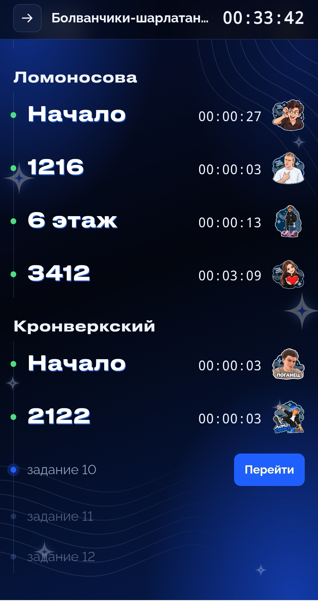
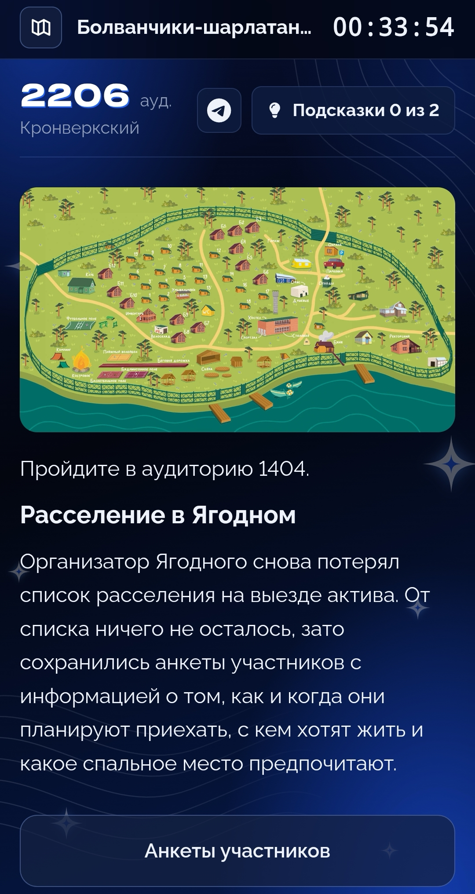
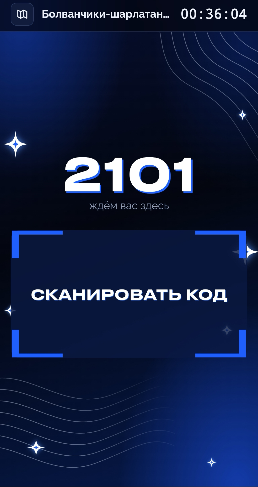

# Quest Platform

Платформа для проведения мегаквеста 2026

# Изображения

|  |  |  |
| --- | --- | --- | 

# Известные проблемы

- задание с энциклопедиями было пропущено
- модель динамического распределения команд не учитывает аудитории, которые идут за распределяемыми - там скапливается очередь 
- система с зачетом ответа по сигналу с дрампада очень хрупкая

